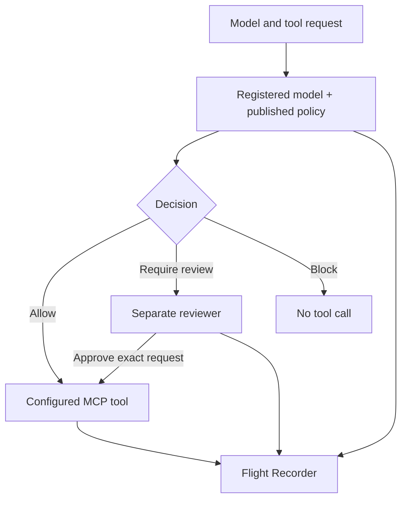

# AEGIS Gateway — AI action governance and Flight Recorder

**A self-hosted technical component for policy checks, human review, and traceable MCP tool calls.**

AEGIS builds on the MCP Guardian policy engine. It adds a controlled execution path and a metadata-only Flight Recorder. This page describes the **synthetic technical evaluation build (v0.7)**. Source code, credentials, patient information, and deployment secrets are not published here.

## See the decision, the review, and the action

The local demo shows three synthetic cases: an allowed tool call, a blocked call, and a call that reaches a mock tool only after human approval. The trace shows the model and policy versions, tool name, source identifiers, decision, reviewer event, and keyed digests of the request and response. The demo runs on localhost without a third-party agent or customer data.

| Capability in v0.7 | What a buyer can inspect |
| --- | --- |
| Gateway checkpoint | Allowed calls reach a configured upstream; blocked calls do not. |
| Human review | A reviewer must approve the exact pending request before it can execute once. The initiating principal cannot self-approve. |
| Version governance | Unknown or disabled model versions are refused. A policy change invalidates pending approvals made under the previous policy version. |
| Flight Recorder | Tenant-scoped events are HMAC-chained; integrity checks detect edits made without the signing key. Raw tool arguments are not retained in this journal. |
| Self-contained demo | One-command local startup with temporary keys, an example model and three synthetic traces. |

## Technical verification

In the seller's Python 3.12 development environment on 28 September 2026, **74 automated tests passed**. A localhost end-to-end check showed the mock tool receiving the allowed action immediately and the review-required action only after approval. These are seller-authored technical tests, not independent security certification or proof of clinical effectiveness.

## Important boundaries

- AEGIS enforces decisions for calls **routed through its gateway**. A separate direct path to a tool can bypass it; a buyer pilot must close that path.
- The gateway processes tool arguments in memory and forwards them to the buyer-configured upstream. The journal stores selected IDs and keyed digests. Identifiers must not contain personal information.
- The demo uses synthetic records, temporary bearer credentials and SQLite. It is not a production deployment, a HIPAA/GDPR compliance claim, or a medical device claim.
- An operator with both database write access and the HMAC key can rewrite a journal. Stronger audit evidence requires external anchoring and controlled key custody.
- The optional MEDTRACE healthcare example is a **synthetic clinician-facing prototype**, not validated for patient care or diagnosis.

## Evaluation path

AEGIS is available for a scoped **technical evaluation** of an organization's AI tool workflow. A buyer can review the synthetic demo, define one MCP integration and agree on acceptance tests for access control, decisions, trace completeness, uncertain delivery and operational security. Commercial terms depend on the integration scope. No enterprise price or production certification is asserted here.

AEGIS v0.7 is a separate evaluation build from the [MCP Guardian v1.1.0 source license and acquisition offer](README.md). Inclusion in a Guardian license or acquisition is subject to its own written agreement.

For a technical evaluation inquiry, contact [Inkh95 on GitHub](https://github.com/Inkh95).
